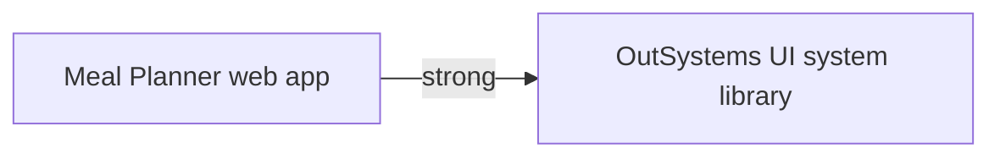

# Meal Planner on OutSystems Developer Cloud

One web app, Meal Planner, holds the household data, the server actions, and the screens. There is no second web app and no library. The theme stays in this app, on top of OutSystems UI.

The Vue app is the behavior. Where the README and the code disagree, this design follows the code and cites the file. Firebase, Firestore, Calculate Nutrition, and the recipe generator are omitted because the brief requires that. The user types the nutrition values.

## 1. What the application does

Two people share one household. Plans, recipes, sources, and settings are household-wide. The README states that, and the documents confirm it: `Settings`, `Source`, `Recipe`, and `MealPlan` have no user id (`src/models/settings.ts`, `src/models/source.ts`, `src/models/recipe.ts`, `src/models/meal-plan.ts`). `firestore.rules` allows every read and write when the request is authenticated, and it does not distinguish the two people.

A signed-in person can open the screens below. Login, the two password-reset screens, and the error screen are also reachable signed out. `src/router/index.ts` sends every route without `allowAnonymous` to `/login`. Only `src/pages/login.vue` and `src/pages/error.vue` set `allowAnonymous: true`.

| Screen              | Vue page                             | What a signed-in person can write                                                                                       |
| ------------------- | ------------------------------------ | ----------------------------------------------------------------------------------------------------------------------- |
| Dashboard           | `src/pages/dashboard/index.vue`      | Nothing. Reads today, this week, and next week.                                                                         |
| Dashboard meal      | `src/pages/dashboard/recipes.vue`    | Nothing. Reads today's items for one meal type. This page is implemented and tested. It is not a placeholder.           |
| Planning            | `src/pages/planning/index.vue`       | Nothing. Reads this week, next week, and the four previous weeks.                                                       |
| Weekly plan         | `src/pages/planning/week.vue`        | Removes a meal item, which can also remove an emptied meal and an emptied plan.                                         |
| Add meal item       | `src/pages/planning/add.vue`         | Creates the plan, the meal, and the item as one write.                                                                  |
| Update meal item    | `src/pages/planning/update.vue`      | Updates the item, and when the date or meal type changes, moves it and cleans up the emptied meal or plan as one write. |
| Recipes             | `src/pages/recipes/index.vue`        | Nothing. Searches and filters.                                                                                          |
| Pick a recipe type  | `src/pages/recipes/add.vue`          | Nothing.                                                                                                                |
| Add homemade recipe | `src/pages/recipes/add-homemade.vue` | Creates a homemade recipe, its ingredients, and its steps.                                                              |
| Add prepared recipe | `src/pages/recipes/add-prepared.vue` | Creates a prepared recipe.                                                                                              |
| Recipe              | `src/pages/recipes/[id]/index.vue`   | Deletes the recipe when no meal item uses it. A used recipe stays, and the screen explains why.                         |
| Update recipe       | `src/pages/recipes/[id]/update.vue`  | Replaces the recipe and its ingredients and steps.                                                                      |
| Settings            | `src/pages/settings.vue`             | Updates the single settings row.                                                                                        |
| Sources             | `src/pages/sources/index.vue`        | Deletes a source that is not protected and not used.                                                                    |
| Add source          | `src/pages/sources/add.vue`          | Creates a source.                                                                                                       |
| Update source       | `src/pages/sources/[id]/update.vue`  | Updates a source's name, description, and URL.                                                                          |

`src/pages/index.vue` only redirects to `/dashboard`. It is not a screen a person uses.

The README says the dashboard also shows previous weeks. `src/pages/dashboard/index.vue` shows This Week and Next Week only. Previous weeks are on `src/pages/planning/index.vue`.

The README describes calorie, sugar, and protein targets and a symmetric tolerance. `src/models/settings.ts` and `src/components/settings/SettingsEditor.vue` store a minimum and a maximum for calories, protein, fat, carbs, and sodium, a maximum only for sugar, a tolerance, and the week-start day.

`src/models/portion.ts` is not written by any page. This design has no Portion entity.

## 2. The architecture answers

These are the seven questions in Building a well-architected app, answered for this household.

**Business concepts.** Recipe, recipe ingredient, recipe step, source, meal plan, meal, meal item, and household settings. Category, cuisine, difficulty, recipe kind, unit of measure, and meal type are fixed lists. A meal item keeps its own name, servings, and nutrition after it is saved. A week summary is calculated, not stored.

**Organizational structure.** One household. The two people do the same work. There are not two teams, two release cycles, or two owners.

**Portfolios.** One portfolio. App architecture with multiple portfolios applies to an organization that already has several portfolios. Nothing here is shared with a second portfolio, so there is no cross-portfolio library and no REST API.

**Owner and sponsor.** One owner and one sponsor: the household that uses the app. The two people are not two owners of two contexts.

**Owner and sponsor against the contexts.** Recipes, sources, plans, and settings change together and are used by the same people. They are one context with one owner and one sponsor.

**Team independence.** One team. Building a well-architected app says that one team, one owner, and one sponsor start as one app. A second app would add service actions. A service action commits its own transaction when it returns, and the caller cannot roll it back (Transactions in external entities). Creating a plan, a meal, and an item, or moving an item and then removing the emptied meal and plan, is one write in `src/data/meal-plans.ts`. That write stays inside this app.

**Non-functional requirements.** One database, so a foreign key inside the app can use Protect or Delete. Referential integrity for a source that is still used by a recipe, for a recipe that is still used by a meal item, and for ingredients and steps that belong to a recipe. No external system and no reusable component for another asset. The built-in identity provider is the only integration, and it is a platform service, not a business integration.

Cloud-native architecture of OutSystems Developer Cloud gives each app its own runtime container and uses the stage's database. One app is the right size for one household interface. The architecture page allows a single app for one business need with one web interface.

## 3. Assets

| Display name | Type    | Why it exists                                                                    | What it owns                                                                         | What it must not contain                                                                                                                                    |
| ------------ | ------- | -------------------------------------------------------------------------------- | ------------------------------------------------------------------------------------ | ----------------------------------------------------------------------------------------------------------------------------------------------------------- |
| Meal Planner | Web app | One business need, one web interface, one owner, one sponsor, one release cycle. | Every entity, static entity, structure, server action, screen, block, and the theme. | A second asset, a service action, a public server action, a library, a mobile app, an agentic app, a `UserId` on household data, Firebase, and an AI model. |

OutSystems UI is the system library the theme is based on. That dependency is strong: 1-Click Publish bundles the libraries the app uses. This design adds no library of its own. A library is for a stateless piece another asset consumes. Themes can be shared only by a theme library, and this app's theme is not public. There is no consumer, so there is no library to release.

There is no weak edge. Nothing consumes a service action or a public entity.

**Implementation order.** Create the Meal Planner web app and leave it empty of business entities and screens. OutSystems UI is already available. Apply the prompts in `build-odc.md` in order. Publish is a separate step the person takes in ODC Studio. The bootstrap timer is scheduled to run when the app is published, which is the schedule Create and run Timers describes for bootstrap data. There is no library release before a consumer, because there is no library.

## 4. Data

Every entity and static entity is private to Meal Planner. Public is No. Reuse elements across apps says a public entity in a web app is readable by other apps, and a server action cannot be public in an app. Nothing else reads this data.

Identifiers stay the platform default: `Id`, Long Integer, AutoNumber. The identifier attribute cannot be renamed after the first publish. The Vue string ids, including `restaurant`, are not copied onto `Id`. The protected source is found by `IsProtected`, because that is the fact the delete rule needs after the Firestore id is gone.

Text has no null. An empty description or URL is `""`. The only null is an entity identifier (`NullIdentifier()`), from Date and time notes. Decimal attributes hold the nutrition numbers and servings. The meal-item editor uses a number input without a fixed precision, and scaling multiplies (`src/components/meals/MealItemEditor.vue`). A Decimal has at most 8 digits in the decimal part.

Text lengths follow Best practices for data management: stay at or under 2000 so the text remains on the owning entity. The Vue forms do not show a maximum-length message. These lengths are the platform attribute lengths.

| Attribute use                 | Length |
| ----------------------------- | ------ |
| Names                         | 200    |
| Description, step instruction | 2000   |
| URL                           | 500    |

### Static entities

A static entity in an app is a table. Its records have `Id`, `Label`, `Order`, and `Is_Active`. Logic uses the record identifier, such as `Entities.MealType.Breakfast`. `Is_Active` is true for every record below. Users cannot add or edit these records.

**WeekDay.** Sunday, Monday, Tuesday, Wednesday, Thursday, Friday, Saturday. `Order` is 0 through 6, matching `WeekDay` in `src/models/settings.ts` (0 is Sunday). Label is the English name.

**MealType.** Breakfast, Lunch, Dinner, Snack. Order 1 through 4. The label of Snack is Snack. The dashboard card says Snacks. That word is a screen label, not a second record. `src/pages/dashboard/index.vue` uses type `Snack` and label `Snacks`.

**RecipeKind.** Homemade and Prepared. Custom attribute `Code`, Text, length 20: `homemade` and `prepared`. Search compares that code (`src/data/recipes.ts`).

**RecipeCategory.** The order in `src/data/recipe-categories.ts`: Appetizer, Beverage, Breakfast, Bread, Grain, Pasta, Beef, Pork, Lamb, Poultry, Seafood, Vegetarian, Side Dish, Soup, Salad, Sauce, Dessert. Label is that name. Order follows the file.

**Cuisine.** The order in `src/data/cuisines.ts`: American, Chinese, French, Greek, Indian, Italian, Japanese, Mediterranean, Mexican, Middle Eastern, Thai.

**RecipeDifficulty.** Easy, Normal, Advanced. Order follows `src/data/recipe-difficulties.ts`.

**UnitType.** Volume, Weight, Quantity.

**UnitSystem.** Metric, Customary, None.

**UnitOfMeasure.** One record per row of `src/data/units-of-measure.ts`. Custom attributes: `Code` Text 20 (the Vue id: `ml`, `l`, `tsp`, `tbsp`, `floz`, `cup`, `pint`, `quart`, `gallon`, `mg`, `g`, `kg`, `oz`, `lb`, `piece`, `item`, `each`, `pinch`, `serving`), `UnitType` UnitType Identifier, `UnitSystem` UnitSystem Identifier. Label is the long name (Milliliter, Liter, and the rest of that file). Order follows the file. A static entity in an app may reference only other static entities. `Code` is the token the recipe view prints. When `Code` is `item`, the view prints the quantity and the ingredient name and omits the unit (`src/components/recipes/RecipeView.vue`).

### Entities

**Settings.** One row.

| Attribute                          | Type               | Mandatory |
| ---------------------------------- | ------------------ | --------- |
| MinDailyCalories, MaxDailyCalories | Decimal            | Yes       |
| MinDailyProtein, MaxDailyProtein   | Decimal            | Yes       |
| MinDailyFat, MaxDailyFat           | Decimal            | Yes       |
| MinDailyCarbs, MaxDailyCarbs       | Decimal            | Yes       |
| MinDailySodium, MaxDailySodium     | Decimal            | Yes       |
| MaxDailySugar                      | Decimal            | Yes       |
| Tolerance                          | Decimal            | Yes       |
| WeekStartDay                       | WeekDay Identifier | Yes       |

No index beyond the primary key. The row is a singleton, not a searched list. Defaults, written only when the row is missing, come from `src/data/settings.ts`: calories 1950 and 2150, protein 140 and 160, carbs 210 and 235, fat 60 and 75, sodium 1500 and 2300, sugar 38, tolerance 10, week start Sunday.

Site settings are the wrong place for these values. Best practices for data management says a setting is read-only at runtime and is changed in the ODC Portal. These values are saved from the Settings screen.

**Source.**

| Attribute   | Type      | Mandatory                       |
| ----------- | --------- | ------------------------------- |
| Name        | Text 200  | Yes                             |
| Description | Text 2000 | No, stored as `""` when omitted |
| Url         | Text 500  | No, stored as `""` when omitted |
| IsProtected | Boolean   | Yes, default false              |

`IsProtected` is not indexed. A Boolean has too little variation to be worth an index, and only the bootstrap action sets it true. There is no unique index on Name. Uniqueness is trim and case-insensitive, which a unique index would not apply, and a database error would replace the message the form shows.

The bootstrap row is Name `Generic Restaurant`, empty description, empty URL, `IsProtected` true. That matches the test source in `src/data/__tests__/test-data.ts` and the id constant in `src/data/sources.ts`. The constant itself is not stored.

**Recipe.**

| Attribute                                    | Type                        | Mandatory                                                                    | Delete rule |
| -------------------------------------------- | --------------------------- | ---------------------------------------------------------------------------- | ----------- |
| Name                                         | Text 200                    | Yes                                                                          |             |
| Description                                  | Text 2000                   | No, `""` when the trimmed value is empty. The Vue value `null` becomes `""`. |             |
| Kind                                         | RecipeKind Identifier       | Yes                                                                          | Protect     |
| SourceId                                     | Source Identifier           | No. `NullIdentifier()` for homemade. Required by the form for prepared.      | Protect     |
| Category                                     | RecipeCategory Identifier   | Yes                                                                          | Protect     |
| Cuisine                                      | Cuisine Identifier          | Yes                                                                          | Protect     |
| Difficulty                                   | RecipeDifficulty Identifier | Yes. Prepared saves Easy.                                                    | Protect     |
| Servings                                     | Decimal                     | Yes                                                                          |             |
| PrepTimeMinutes                              | Integer                     | Yes. Prepared saves 0.                                                       |             |
| CookTimeMinutes                              | Integer                     | Yes. Prepared saves 0.                                                       |             |
| Calories, Sodium, Sugar, Carbs, Fat, Protein | Decimal                     | Yes                                                                          |             |

Index: `SourceId`. The relationship index is created with the reference. Prepared recipes still store Easy, 0, 0, and no child rows, because `createRecipeFromForm` in `src/components/recipes/RecipeEditor.vue` writes those values. The form does not ask for them.

No unique index on Name. A homemade name is unique among homemade recipes. A prepared name is unique among prepared recipes with the same source. The comparison trims and ignores case (`src/components/recipes/RecipeEditor.vue`).

**Ingredient.**

| Attribute       | Type                     | Mandatory | Delete rule |
| --------------- | ------------------------ | --------- | ----------- |
| RecipeId        | Recipe Identifier        | Yes       | Delete      |
| Order           | Integer                  | Yes       |             |
| Units           | Decimal                  | Yes       |             |
| UnitOfMeasureId | UnitOfMeasure Identifier | Yes       | Protect     |
| Name            | Text 200                 | Yes       |             |

Index: `RecipeId` from the relationship. `Order` is the list position. The Vue array has no separate order field. The child entity needs one.

**Step.**

| Attribute   | Type              | Mandatory | Delete rule |
| ----------- | ----------------- | --------- | ----------- |
| RecipeId    | Recipe Identifier | Yes       | Delete      |
| Order       | Integer           | Yes       |             |
| Instruction | Text 2000         | Yes       |             |

**MealPlan.**

| Attribute | Type | Mandatory |
| --------- | ---- | --------- |
| Date      | Date | Yes       |

Unique index on `Date`. One plan per calendar date. `getMealPlanForDate` in `src/data/meal-plans.ts` returns one plan. Date is stored as the calendar date the person picked. Date values are stored as entered, with no time-zone conversion.

**Meal.**

| Attribute  | Type                | Mandatory | Delete rule |
| ---------- | ------------------- | --------- | ----------- |
| MealPlanId | MealPlan Identifier | Yes       | Delete      |
| MealTypeId | MealType Identifier | Yes       | Protect     |

Unique index on (`MealPlanId`, `MealTypeId`). The add and update logic never creates a second meal of the same type on a plan.

**MealItem.**

| Attribute                                    | Type              | Mandatory | Delete rule |
| -------------------------------------------- | ----------------- | --------- | ----------- |
| MealId                                       | Meal Identifier   | Yes       | Delete      |
| RecipeId                                     | Recipe Identifier | Yes       | Protect     |
| Name                                         | Text 200          | Yes       |             |
| Servings                                     | Decimal           | Yes       |             |
| Calories, Sodium, Sugar, Carbs, Fat, Protein | Decimal           | Yes       |             |

`RecipeId` uses Protect. Relationships between entities says Protect is the rule when a person can delete the parent from a screen and the child must keep the parent from disappearing. `removeRecipe` in `src/data/recipes.ts` deletes the recipe and does not look at meal items. This design does not follow that delete. DeleteRecipe checks for a meal item first, refuses when one exists, and the database rule blocks the delete as well. The six nutrition attributes stay a snapshot on the item. They are not read back from the recipe when the item is shown. The dashboard meal page still has the "Recipe unavailable." branch from `src/pages/dashboard/recipes.vue`. A successful delete cannot create that state.

### Structures

Structures are not stored and are not public. They are not service-action parameters, so they cannot be public on a web app.

**Nutrition.** Calories, Sodium, Fat, Protein, Carbs, Sugar, all Decimal. It passes a snapshot into scaling and into the status actions. The same six numbers are columns on Recipe and MealItem because an entity attribute is scalar.

**WeeklySummary.** StartDate Date, EndDate Date, DaysWithMeals Integer, AverageCalories, AverageProtein, AverageCarbs, AverageFat, AverageSugar, AverageSodium, all Decimal. It is the output of the week calculation. It is not an entity. `src/core/build-weekly-data.ts` builds it on read.

### Reads

Screen aggregates read Source, Recipe, Ingredient, Step, MealPlan, Meal, MealItem, and Settings. A data action builds a WeeklySummary when one aggregate is not the average the screen shows. SQL is not used. Query data using SQL reserves SQL for window functions, stored procedures, dynamic IN lists, and bulk operations. These reads are joins and date filters. Best practices for fetching and displaying data says to prefer aggregates.

The recipe list shows every match and a count of matches against the full library, as `src/pages/recipes/index.vue` does. This is one household library, so the screen does not page that list.

`src/data/meal-plans.ts` only subscribes to plans from five weeks before the Sunday of the current week. The screens read the dates they display. A weekly plan opened with a valid `weekStartDate` older than that window can show rows here and look empty in the Vue app. The week boundaries themselves follow `settings.weekStartDay`, not that Sunday window.

## 5. Logic

All of these are server actions in Meal Planner, except the two status actions, which are client actions because they only format a color and do not write. None of them is a service action. A service action would commit before the caller finished, and no other asset calls these.

Failure text below is the text the Vue screen shows. Server actions enforce the same rules so a bypassed form cannot skip them.

### BootstrapReferenceData

Timer **BootstrapOnPublish**. Schedule: run when the app is published. Create and run Timers allows that schedule for bootstrap data, and it also runs after an automatic patch. Timeout stays 20 minutes. The action is safe to run again. Timers are scheduled in UTC (ODC for O11 developers). This timer has no clock time.

The action inserts a Settings row only when none exists, using the defaults in section 4. It inserts the Generic Restaurant source only when no source has `IsProtected` true. It does not import `seed-data`. The O11 comparison says the Schedule property is not accessible in development. If Studio does not offer "when published", set that schedule in the ODC Portal after the first publish. Do not give the timer a daily clock time.

### UpdateSettings

Input: the Settings attributes. Updates the single row. Does not insert a second row.

Form messages from `src/core/validation-rules.ts`, `src/components/settings/NutrientRangeRow.vue`, `src/components/settings/NutrientMaxRow.vue`, and `src/components/settings/SettingsEditor.vue`:

- Required fields: `Required`
- Each minimum and maximum, and the sugar maximum: `Must be a positive number`, or `Must be a valid positive number` when the value is not a number
- `Minimum {nutrient} must be less than maximum {nutrient}`
- `Maximum {nutrient} must be greater than minimum {nutrient}`
- The nutrient name in those two messages is lower case: calories, protein, fat, carbs, sodium
- Tolerance: `Required`, `Must be zero or greater`, `Must be a valid number zero or greater`, and `Tolerance must be 100 or less`
- Week start: `Required`

Replaces `updateSettings` in `src/data/settings.ts`. The screen stays on Settings.

### AddSource and UpdateSource

Inputs: Name, Description, Url, and for update the Source id. Trim the name. Description and URL are trimmed. An empty optional value is stored as `""`. `IsProtected` is false on add and is not changed on update.

Messages:

- Empty name: `Required`
- Another source with the same trimmed name, ignoring case: `"that name" already exists`, with the trimmed typed name inside the quotes (`mustBeUnique` in `src/core/validation-rules.ts`)
- A non-empty URL that is not `http:` or `https:`: `Must be an http or https URL`

Replaces `addSource` and `updateSource` in `src/data/sources.ts`.

### DeleteSource

Input: Source id.

- `IsProtected` true: do not delete. The list hides the control (`src/pages/sources/index.vue`).
- Any recipe has this SourceId: do not delete. The screen shows title `Source in use` and message `This source is used in recipes and cannot be deleted.`
- Otherwise delete.

The list also shows `Recipes have failed to load, deletion of sources is disabled` and hides delete when recipes fail to load. That is a screen state. The action still refuses a protected or used source.

### AddRecipe and UpdateRecipe

Input: the recipe fields, plus the ingredient list and the step list in order. One action writes the recipe and replaces its children, so the recipe and its lists commit or roll back together. An uncaught exception rolls back the database transaction.

Homemade requires category, cuisine, servings, difficulty, both times, and all six nutrition numbers. Prepared requires those shared fields and a source, then stores difficulty Easy, both times 0, and no ingredient or step rows. A missing kind is not stored. New recipes always have a kind. The Vue search treats a missing kind as homemade only for old Firestore documents (`src/data/recipes.ts`). There is no import of those documents.

Name rule, from `src/components/recipes/RecipeEditor.vue`: trim, required, unique ignoring case among recipes of the same kind, and for prepared also the same source, excluding the recipe being edited. Message: `"trimmed name" already exists`. While the recipe list is still loading, the form shows `Recipes are still loading` and does not save.

Other form messages: `Required`, `Must be a positive number` for servings, `Must be zero or greater` for the two times, and the nutrition messages below.

An ingredient row is kept only when units is a number greater than 0, the name is non-empty after trim, and a unit is selected (`isValidIngredient`). A step is kept only when the instruction is non-empty after trim. Empty lists are allowed. Order is the kept order, starting at 1.

Replaces `addRecipe` and `updateRecipe` in `src/data/recipes.ts`.

### DeleteRecipe

Input: Recipe id. The action checks usage before it writes.

- If any meal item has this RecipeId, do not delete. The screen shows the notification title `Recipe in use` and the message `This recipe is used in meals and cannot be deleted.` The person stays on the recipe. This follows the source notification in `src/pages/sources/index.vue`: title `Source in use`, message `This source is used in recipes and cannot be deleted.`
- Otherwise delete the recipe. Delete rules delete its ingredients and steps. The screen has already asked `Are you sure you want to delete {name}?`

The Vue action `removeRecipe` does not perform this check. The check is an explicit change from that function.

### AddMealItem

Inputs: Date, MealType, Recipe id, Name, Servings, and Nutrition. One action:

- If no plan exists for the date, create the plan, one meal of that type, and the item.
- If the plan exists without that meal type, add the meal and the item.
- If the meal exists, append the item.

This is the body of `addMealItemToMealPlan` in `src/data/meal-plans.ts`. The screen passes the name from the recipe's name, not the "name (source)" label. Servings must be a positive number. Date and meal type are required. The date must be one of the seven dates of the open week.

### UpdateMealItem

Inputs: the original date, the original meal type, and the new date, meal type, recipe id, name, servings, and nutrition. One action, matching `updateMealItemInMealPlan` and `moveMealItemToNewDate`:

- Same date and same meal type: replace the item's name, recipe, servings, and nutrition.
- Same date, different meal type: remove the item from the old meal, drop that meal if it has no items, and append the item to the destination meal, creating that meal when it is absent. Do not delete the plan.
- Different date: remove the item from the source meal, drop an empty meal, delete the source plan when it has no meals left, and add the item to the destination plan, creating that plan and meal when needed.

If the source plan is gone, write nothing. The Vue function logs to the console and shows no dialog (`src/data/meal-plans.ts`). This action shows no dialog either.

### RemoveMealItem

Inputs: Date, MealType, MealItem id. One action, matching `removeMealItemFromMealPlan`:

- If the plan is gone, write nothing and show no dialog.
- Remove the item. Drop the meal when it has no items. Delete the plan when it has no meals.

The screen asks `Are you sure you want to delete this item from the meal?` first.

### Scaling, before the write

The editor does this on the client, then the save actions store the numbers it submits. `src/components/meals/MealItemEditor.vue`:

- Changing the recipe sets nutrition to the recipe's per-serving values multiplied by the current servings.
- Changing servings multiplies the current nutrition, including a typed override, by the new servings divided by the previous servings.
- The stored name is the recipe name at save time.

### BuildWeeklySummary

Data action. Input: the week start Date, already aligned to `WeekStartDay` by the screen. The screen computes that date on the client. Client date functions return the device's local date, which is what `new Date()` does in the Vue pages. A server date function returns UTC, so "today" must not be calculated on the server.

End date is six days after the start. Load meal plans in that inclusive range. Days with meals is the number of those plans that have at least one meal. Each average is the nutrient summed across those plans, divided by the day count, or by 1 when the day count is 0, then rounded to an integer. That is `buildWeeklyData` and `daysWithMeals` in `src/core/build-weekly-data.ts` and `src/core/nutritional-calculations.ts`. Output: WeeklySummary.

### RangeStatus and MaxOnlyStatus

Client actions. They implement `src/core/nutritional-status.ts`.

RangeStatus(value, min, max, tolerance) returns no status when any input is missing or not a number. Otherwise the allowed deviation is `((max + min) / 2) * (max(tolerance, 0) / 100)`.

- `min` through `max`, inclusive: in zone
- below `min` but at least `min - deviation`: low warning
- above `max` but at most `max + deviation`: high warning
- further below: low danger
- further above: high danger

MaxOnlyStatus(value, max, tolerance) uses deviation `max * (max(tolerance, 0) / 100)`. At or below `max` is in zone. At or below `max + deviation` is high warning. Above that is high danger. It never returns a low status.

Sugar uses MaxOnlyStatus. Calories, protein, fat, carbs, and sodium use RangeStatus (`src/components/portions/NutritionData.vue`).

### Other messages

| Where                | Text                                             |
| -------------------- | ------------------------------------------------ |
| Confirm dialog title | Are you sure?                                    |
| Confirm buttons      | Yes and No                                       |
| Delete an ingredient | Are you sure you want to delete this ingredient? |
| Delete a step        | Are you sure you want to delete this step?       |
| Delete a recipe      | Are you sure you want to delete {name}?          |
| Delete a source      | Are you sure you want to delete {name}?          |
| Notification button  | OK                                               |
| Login failure        | Login failed. Please try again.                  |
| Login email          | Required, and Invalid e-mail                     |
| Login password       | Required                                         |

Nutrition inputs, on the recipe and on the meal item: `Required`, `Must be zero or greater`, and `Must be a valid number zero or greater` (`src/components/portions/NutritionEditorRows.vue`).

## 6. Interface

Two UI flows. UI flows group screens, and each flow uses the app theme.

**AnonymousFlow** uses LayoutBlank, the layout with no menu. Screens: Login, RecoverPasswordRequest, RecoverPasswordReset.

**MainFlow** uses LayoutSideMenu. Every other screen, including Error. `src/pages/error.vue` sets `allowAnonymous` and does not set `layout: standalone`. Only login and the redirecting index page set the standalone layout. The error screen therefore keeps the menu. Login does not.

The default screen is Dashboard. A registered screen sends an anonymous person to Login, which is the same redirect as `checkAuthStatus`. `src/pages/index.vue` has no content of its own.

LayoutSideMenu is the side menu in the theme documentation. On a wide screen the menu is permanent and uses the items below. The Vue rail is `expand-on-hover` and `permanent` (`src/layouts/components/DefaultDesktopLayout.vue`). The themes page describes a menu-behavior parameter and does not describe expand-on-hover. Use the closest side-menu behavior that stays open, and record the hover gap.

On a narrow screen the same items appear in a temporary menu, and the bar title is Meal Planner (`src/layouts/components/DefaultMobileLayout.vue`). The bar uses the primary color. If LayoutSideMenu cannot title that bar, set the title in the layout header and record the gap. Content width follows the Vue shell: maximum 1024 pixels, centered, padding 2rem, and 1rem when the viewport is 600 pixels or narrower.

Menu order, same on both widths, with a divider before Settings:

| Order | Label              | Vue path                 | Phosphor icon, Regular weight |
| ----- | ------------------ | ------------------------ | ----------------------------- |
| 1     | Dashboard          | `/dashboard`             | squares-four                  |
| 2     | Planning & Logging | `/planning`              | clipboard-text                |
| 3     | Recipes            | `/recipes`               | fork-knife                    |
| 4     | Settings           | `/settings`              | gear                          |
| 5     | Recipe Sources     | `/sources`               | storefront                    |
| 6     | Logout             | calls logout, then Login | sign-out                      |

The Recipes icon in Vue is `mdi-pasta`. The icons page does not name a pasta glyph. fork-knife is the food icon. Recipe Sources uses `mdi-room-service-outline`, a cloche. storefront is the place icon. If either name is missing in the picker, choose the closest Phosphor icon and record the gap. Logout calls the Logout client action and opens Login (`src/layouts/default.vue`).

### Theme

One theme in the web app. Base theme OutSystems UI. Public No. Icon library Phosphor 2.0, the default for a new app (Themes, Use icons). Weights: Regular for menu and content, Bold for the status arrows (Use icons says Bold for emphasis).

`src/plugins/vuetify.ts` uses Material Design 3 and `defaultTheme: 'system'`, so the Vue app follows the operating-system light and dark appearance. The Themes page describes one theme, a theme editor for primary color, secondary color, font, and font size, and custom CSS. It does not describe a theme that switches with the operating system. This app keeps a single OutSystems UI theme. That is a gap, recorded in section 9. Do not add a second theme or a theme library to invent the switch.

Color roles the screens use, by the OutSystems UI role of the same name:

| Vue use                                 | Role      |
| --------------------------------------- | --------- |
| App bar, primary chips, primary buttons | primary   |
| Secondary chips, secondary buttons      | secondary |
| Calorie chip on a recipe card           | tertiary  |
| In zone                                 | success   |
| Low warning and high warning            | warning   |
| Low danger and high danger, delete      | error     |

Status icons, from `src/components/core/NutritionalStatusMarker.vue`:

| Status       | Phosphor   | Weight  | Color   | Accessible name |
| ------------ | ---------- | ------- | ------- | --------------- |
| in zone      | circle     | Regular | success | In zone         |
| low warning  | arrow-down | Bold    | warning | Low warning     |
| low danger   | arrow-down | Bold    | error   | Low danger      |
| high warning | arrow-up   | Bold    | warning | High warning    |
| high danger  | arrow-up   | Bold    | error   | High danger     |

Other icons:

| Vue icon                     | Use                                 | Phosphor              |
| ---------------------------- | ----------------------------------- | --------------------- |
| mdi-plus                     | Add                                 | plus                  |
| mdi-pencil                   | Modify an item                      | pencil-simple         |
| mdi-delete                   | Delete an item                      | trash                 |
| mdi-close                    | Remove a source from the list       | x                     |
| mdi-delete-forever           | Delete an ingredient or step        | trash                 |
| mdi-fire                     | Calories                            | fire                  |
| mdi-coffee-outline           | Breakfast                           | coffee                |
| mdi-clock-outline            | Prep time                           | clock                 |
| mdi-timer-outline            | Cook time                           | timer                 |
| mdi-clock-time-four-outline  | Total time                          | clock                 |
| mdi-account-multiple-outline | Servings                            | users                 |
| mdi-chef-hat                 | Difficulty, and the prepared choice | chef-hat              |
| mdi-storefront               | Source on a prepared recipe         | storefront            |
| mdi-format-list-bulleted     | Meal-item nutrition                 | list-bullets          |
| mdi-help-rhombus             | Confirm dialog                      | question              |
| mdi-alert-circle             | Error notification                  | warning-circle        |
| mdi-gas-burner               | Homemade choice                     | flame                 |
| mdi-death-star-variant       | Error page                          | warning-circle, large |

These Vue icons have no close Phosphor name in the icons documentation. Use the closest food icon the picker offers and record the gap: `mdi-food-steak`, `mdi-candy-outline`, `mdi-baguette`, `mdi-shaker-outline`, `mdi-french-fries`, `mdi-food-turkey`, `mdi-peanut-outline`, `mdi-food-outline`.

### Blocks

NutritionSummary shows the six numbers in the order calories, protein, carbs, then sodium, fat, sugar, with the units g or mg from `src/components/portions/NutritionData.vue`. It shows a status icon only when settings are passed. The recipe page and the meal-item tooltip do not pass settings. The daily-title tooltip and the weekly card do.

NutritionEditor is the six inputs. WeeklySummaryCard and DailySummaryCard match the Vue cards. RecipeSummaryCard, RecipeView, RecipeEditor, MealItemEditor, SourceEditor, and SettingsEditor are the editors and views below. ConfirmDialog and NotificationDialog use the copy in section 5.

### Screens

Anonymous means the screen can be opened signed out. Every other screen requires a signed-in user and has no custom role.

**Login.** Replaces `src/pages/login.vue` and `src/components/auth/LoginCard.vue`. Anonymous. LayoutBlank. Title `Login to Your Account`. Email and password. The button says Login and is enabled only when the form is valid. Success opens Dashboard. Failure shows `Login failed. Please try again.` and stays here. Forgot Password? opens RecoverPasswordRequest. The focus starts in Email.

**RecoverPasswordRequest** and **RecoverPasswordReset.** Anonymous. LayoutBlank. These are the pre-built user screens named in Passwords. Request calls the StartResetPassword system server action. Reset calls the FinishResetPassword system client action. The email contains a verification code and a link to RecoverPasswordReset. Cancel on the request screen returns to Login. This replaces the reset mode inside LoginCard. The Vue strings about a Firebase reset email are not shown, because this flow sends a verification code.

**Error.** Replaces `src/pages/error.vue`. Anonymous, and it uses the MainFlow menu. Title `I find this failure to load to be disturbing.` Subtitle `This is not the page you are looking for.` No buttons. Invalid `weekStartDate` on the weekly plan or on add meal item opens this screen, which is `validateDateParams` in `src/router/index.ts`. The update screen is not in that check.

**Dashboard.** Replaces `src/pages/dashboard/index.vue`. Title `Today's Outlook`. Today is the device's local date. Six stat cards, in order: Protein (g), Sugar (g), Carbs (g), Sodium (mg), Fat (g), Calories. Values are the day's totals, or zero when today has no plan. Status uses the rules in section 5. Sugar is max-only. Four meal cards: Breakfast, Lunch, Dinner, Snacks. The value is that meal's calories, or `N/A` when the meal is absent. A meal card opens Dashboard meal with that type. This Week and Next Week (Planning) open the weekly plan for that week's start. A week card shows the title, the `M/d/yyyy - M/d/yyyy` range, the day count, and the averages with the prefix Average.

**Dashboard meal.** Replaces `src/pages/dashboard/recipes.vue`. The query values breakfast, lunch, dinner, and snack map to headings Breakfast, Lunch, Dinner, and Snacks. Any other value shows `This meal type is not recognized.` and no list. A known type with no items shows `No recipes planned for this meal today.` Each item shows `Planned servings: {n}` and RecipeView when the recipe still exists. Otherwise the item name is the heading and the text is `Recipe unavailable.` Close opens Dashboard.

**Planning.** Replaces `src/pages/planning/index.vue`. Title `Planning & Logging`. Current Weeks holds This Week and Next Week (Planning). Recent Weeks holds the four previous weeks, newest first. A previous card's title is `Weeks Ago: {n}`. Each card opens the weekly plan for its start date.

**Weekly plan.** Replaces `src/pages/planning/week.vue`. Title `Weekly Plan`. Seven days from the given start. A day with no meals says `No meals have been entered`. Otherwise it lists each meal type that has items, in stored order, and each item's name, with modify and delete. The day title's tooltip is the day's nutrition with settings. The item tooltip is nutrition without settings. Modify opens Update meal item. Delete confirms, then RemoveMealItem, and stays here. Close goes back to the screen that opened this week, Dashboard or Planning. Add opens Add meal item and keeps the week start. A missing or invalid start date opens Error.

**Add meal item.** Replaces `src/pages/planning/add.vue`. Title `Add Meal Item`. Save calls AddMealItem and opens the weekly plan for the same week start. Cancel opens that same weekly plan. An invalid start date opens Error.

**Update meal item.** Replaces `src/pages/planning/update.vue`. Title `Update Meal Item`. Save calls UpdateMealItem and opens the weekly plan for the same week start. Cancel does the same. The editor opens with the item's date, type, recipe, servings, and nutrition.

**Meal item editor.** Date is one of the seven week dates, labeled `EEEE, MMMM d`, value `yyyy-MM-dd`. Meal type is Breakfast, Lunch, Dinner, Snack. Recipe options show `name` or `name (source)`. Servings defaults to 1 on add. Save is enabled when the form is valid and, on update, something changed.

**Recipes.** Replaces `src/pages/recipes/index.vue`. Title `My Recipes`. Search placeholder `Search for a recipe...`. Filters: Category, Cuisine, and Calorie Range, each clearable. Ranges are 0-500, 501-750, 751-1000, and 1001+ with no upper bound. A keyword list is the search text split on spaces. Every keyword must match. A keyword matches the name, the description, or an ingredient name by contains, ignoring case. It matches the kind only when the whole keyword equals `homemade` or `prepared`. It matches a source name by contains. Category, cuisine, and calorie bounds are exact filters on top of that (`recipeMatches` in `src/data/recipes.ts`). The count reads `Displaying {shown} of {total} recipe` or `recipes`. No rows at all: `No recipes found.` No rows after filtering: `No recipes match your search criteria.` A card opens the recipe. Add opens Pick a recipe type.

A card shows the name, category, cuisine, description, servings, and `{calories} kcal`. Homemade also shows difficulty and prep plus cook minutes. Prepared shows the source name, or `UNKNOWN` when the source name is missing, and does not show difficulty or time (`src/components/recipes/RecipeSummaryCard.vue`).

**Pick a recipe type.** Replaces `src/pages/recipes/add.vue`. Title `Pick a Recipe Type`. Homemade: `Homemade`, `Simple to complex, some assembly is required.` Opens Add homemade recipe. Prepared: `Prepared`, `Premade meals from a delivery service or restaurant.` Opens Add prepared recipe. Cancel opens Recipes.

**Add homemade recipe** and **Add prepared recipe.** Titles are the editor, not a separate page title in the Vue files. Cancel opens Pick a recipe type. Save creates the recipe and opens Recipes.

**Recipe.** Replaces `src/pages/recipes/[id]/index.vue`. RecipeView, then Close, Modify, and Delete. Close opens Recipes. Modify opens Update recipe. Delete checks usage first. When a meal item still points at the recipe, the notification says `Recipe in use` and `This recipe is used in meals and cannot be deleted.`, and the screen stays here. When nothing uses it, the confirm `Are you sure you want to delete {name}?` runs, DeleteRecipe deletes it, and the screen opens Recipes. Homemade shows difficulty, servings, prep minutes, cook minutes, ingredients, and steps. Prepared shows the source name and servings, and hides ingredients and steps. Description keeps line breaks. Nutrition on this page has no status icons.

**Update recipe.** Replaces `src/pages/recipes/[id]/update.vue`. Cancel opens the recipe when it still exists, otherwise Recipes. Save updates and opens the recipe.

**Recipe editor.** Sections: Basic Information, then Ingredients and Steps for homemade only, then Nutritional Information Per Serving. There is no Calculate Nutrition button. Name is focused on open. Save is enabled when the form is valid and, on update, something changed. Ingredient and step delete each confirm. Enter in the ingredient name or the step instruction adds the next row.

**Settings.** Replaces `src/pages/settings.vue`. The Vue heading is `Meal Planner - v2.2.0`, from `package.json` description and version. This screen's heading is `Meal Planner`. There is no package version to read. Reset restores the values last loaded from Settings. Save calls UpdateSettings and stays here. Save is enabled only when the form is valid and a value changed. There is no Cancel.

**Sources.** Replaces `src/pages/sources/index.vue`. Title `Sources for Recipes`. Empty list: `No sources found`. A row opens Update source. The remove icon is hidden for the protected source and when recipes failed to load. Remove on a used source shows the notification and does not delete. Otherwise it confirms, deletes, and stays here. Add opens Add source.

**Add source** and **Update source.** Cancel and a successful save both open Sources. Save is enabled when the form is valid and, on update, a value changed. The editor labels are Name, Description, and URL. The name placeholder is `Enter the name of the food source...`.

## 7. Identity

Users are built-in identity-provider users. Login and Logout are the client actions in Authentication system actions. Login takes a username and a password and returns UserLoginResult. The username is the email the person types. The session timeout default is 12 hours. Logout ends that session and the screen opens Login.

Password reset uses StartResetPassword and FinishResetPassword on the pre-built screens in Passwords. The app does not call an external provider. GetExternalLoginURL and GetExternalLogoutURL are not used.

No custom role. Secure your app with end-user roles is for people who must not see the same screens or data. `firestore.rules` gives both people the same read and write once they are signed in. Screens that require a signed-in user are every screen except Login, RecoverPasswordRequest, RecoverPasswordReset, and Error.

Business entities do not store a user id. The system User entity is not a foreign key on household data. A reference to User would be Ignore anyway, and this model does not add one.

The emulator has user accounts. This design does not copy them.

## 8. Data access

| Stored fact                                                         | Where           |
| ------------------------------------------------------------------- | --------------- |
| Fixed lists in section 4                                            | Static entities |
| Settings, sources, recipes, ingredients, steps, plans, meals, items | Entities        |
| A nutrition snapshot passed through logic, and a week summary       | Structures only |

There is no Firebase client, no Firestore collection, no external entity, no REST API, no AI model, and no agentic app. The user types calories, sodium, sugar, carbs, fat, and protein on the recipe and can type them again on the meal item. Calculate Nutrition and the recipe generator are not actions and not buttons.

## 9. Behavior the design changes

| What changes                                                                                                                                                                 | Why                                                                                                                                                                                       |
| ---------------------------------------------------------------------------------------------------------------------------------------------------------------------------- | ----------------------------------------------------------------------------------------------------------------------------------------------------------------------------------------- |
| No Firebase Auth, Firestore, or Firebase SDK. Sign-in, sign-out, and password reset use the built-in provider.                                                               | The brief.                                                                                                                                                                                |
| No Calculate Nutrition button and no recipe generator.                                                                                                                       | The brief. The generator is not on a page. The button is on `src/components/recipes/RecipeEditor.vue`.                                                                                    |
| Password reset is RecoverPasswordRequest and RecoverPasswordReset, with a verification code, instead of the reset mode on LoginCard and the Firebase email strings.          | Passwords. The authentication actions page has Login and Logout, not a Firebase-style reset email.                                                                                        |
| The error page icon is warning-circle, not a Death Star. Several food icons use the closest Phosphor icon.                                                                   | Use icons. Phosphor is the new-app library. Those Material glyphs are not in that library.                                                                                                |
| The side menu may not expand on hover. The narrow bar may not match the Vuetify app bar exactly.                                                                             | Themes describes LayoutSideMenu and a menu behavior, not an expand-on-hover rail.                                                                                                         |
| One theme, rather than a theme that follows the operating system.                                                                                                            | Themes describes one app theme. `src/plugins/vuetify.ts` uses `defaultTheme: 'system'`.                                                                                                   |
| Settings heading is `Meal Planner`, without `v2.2.0`.                                                                                                                        | The Vue heading is `package.json`. This app has no package version on the screen.                                                                                                         |
| Empty text is `""`, not null.                                                                                                                                                | Date and time notes: text has no null.                                                                                                                                                    |
| Ingredients and steps are child rows with an Order, and meals are child rows.                                                                                                | Entities do not store a document array. Order preserves the Vue list order.                                                                                                               |
| The protected source is `IsProtected`, not the id `restaurant`.                                                                                                              | Entity identifiers are AutoNumber. The delete rule needs a durable flag.                                                                                                                  |
| A week opened outside the Firestore five-week listener can show plans.                                                                                                       | The screen asks for that week. `src/data/meal-plans.ts` limits the listener. Aggregates read the dates on the screen.                                                                     |
| Attribute lengths are capped as in section 4.                                                                                                                                | Best practices for data management. The Vue forms do not show a length error.                                                                                                             |
| "Today" and the week start are the device date, computed on the client.                                                                                                      | Date and time notes: client date functions are local, server date functions are UTC. The Vue pages use the browser date.                                                                  |
| Deleting a recipe that a meal item still uses is refused. The notification title is `Recipe in use` and the message is `This recipe is used in meals and cannot be deleted.` | Requested change. `removeRecipe` in `src/data/recipes.ts` deletes without this check. MealItem.RecipeId is Protect, the same rule Recipe.SourceId uses for a source that is still in use. |

The error screen keeps the menu. Moving it onto LayoutBlank would be a navigation change. `src/pages/error.vue` does not select the standalone layout.

The dashboard meal screen keeps the behavior in `src/pages/dashboard/recipes.vue`, including an unrecognized type and a missing recipe.

Confirms and validation strings in section 5 are the Vue strings, except the recipe-in-use notification, which is new and follows the source-in-use wording.

## 10. Left out

Firebase and Firestore. Calculate Nutrition. The recipe generator and any other AI feature. An agentic app. A native mobile app and a mobile library. Per-user business data and a `UserId` on household entities. A second portfolio and cross-portfolio REST. Importing `seed-data`, including the emulator accounts. An OutSystems 11 module, Architecture Canvas layer, or a name ending in `_CS`, `_BL`, `_Th`, `_CW`, `_API`, or `_Lib`. A Portion entity. A service action. A library.
